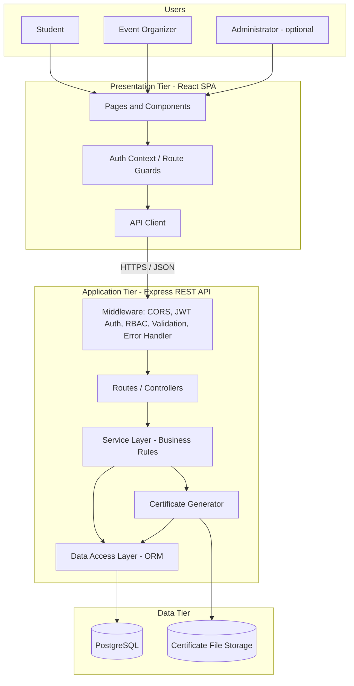
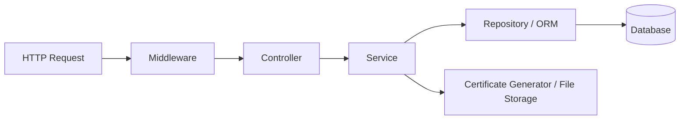
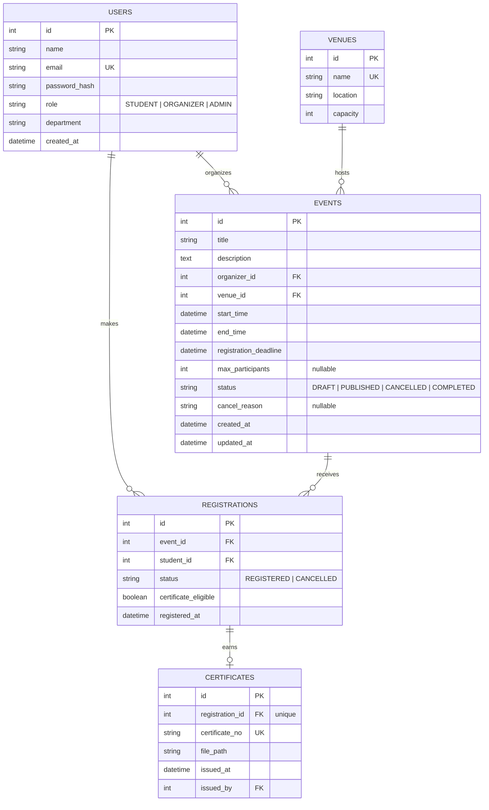
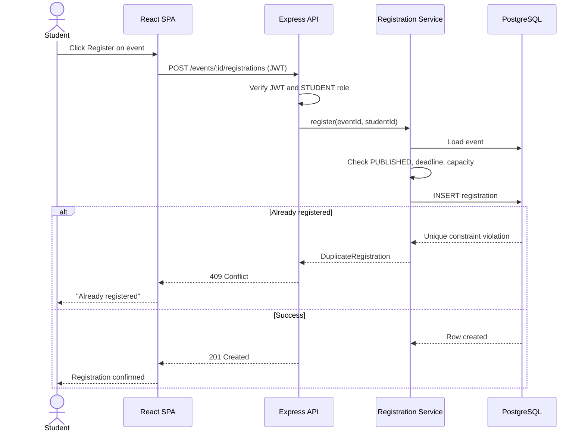
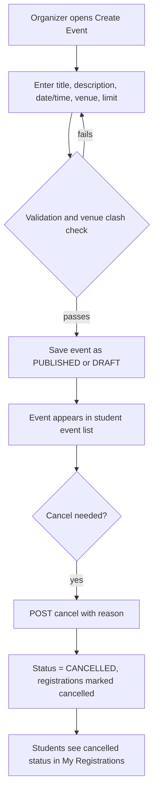
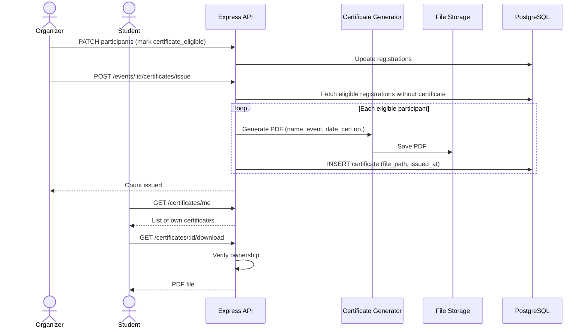
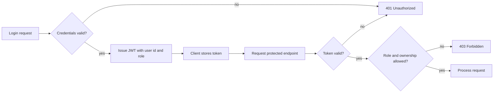
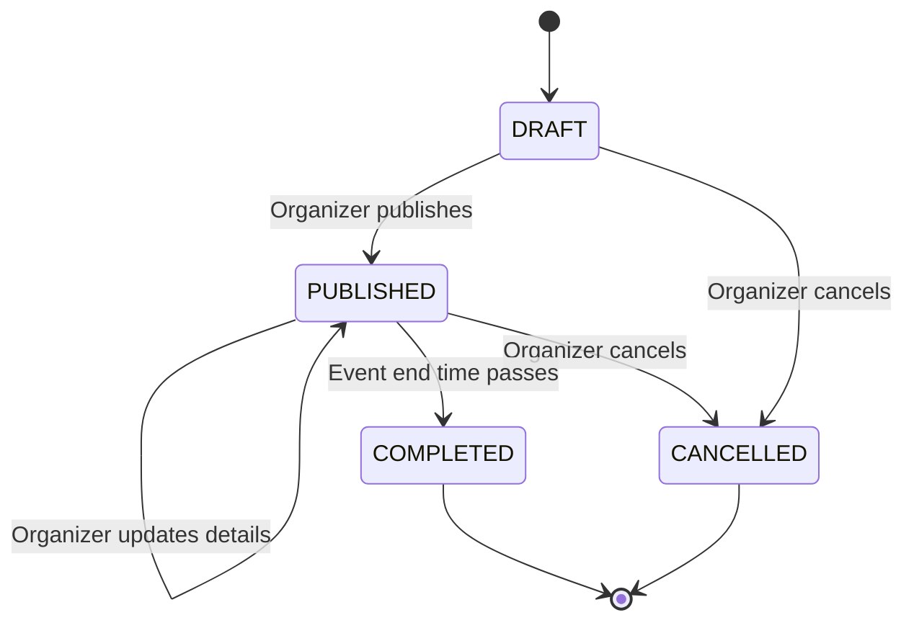
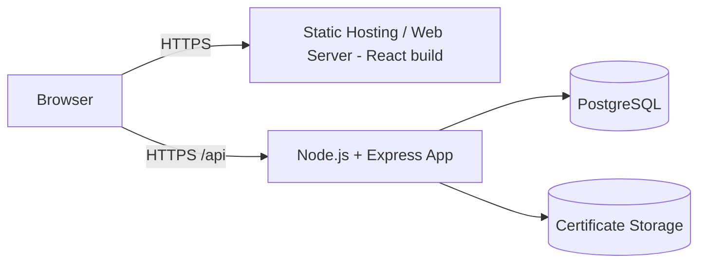

# College Event Management System — System Architecture

| Item | Details |
|---|---|
| Project | College Event Management System |
| Document | System Architecture (Design Phase) |
| Based on | Project Plan (last updated 12 Nov 2026) |
| Status | Proposed – pending team review |

> The project plan states that the technology stack and detailed architecture will be determined during design. The stack below is a **proposal** suited to a prototype and can be swapped without changing the overall structure.

---

## 1. Architecture Goals

| Goal | How the architecture addresses it |
|---|---|
| Centralized event platform | Single web application backed by one shared database |
| Prevent duplicate registrations | Enforced in the database (unique constraint) and checked in the service layer |
| Two main roles (Student, Organizer) plus optional Admin | Role-based access control (RBAC) on every protected endpoint |
| Certificates for eligible participants | Organizer-controlled issuance; PDF generated and stored; students download only their own |
| Prototype scope, small team | Simple layered monolith, easy to build, test and demo |
| Out-of-scope items kept out | No payment, QR attendance, AI recommendations, mobile apps, or SMS modules |

## 2. Architectural Style

A **three-tier layered monolith**:

1. **Presentation tier**: responsive web single-page application (SPA).
2. **Application tier**: one REST API server organized into modules.
3. **Data tier**: relational database plus file storage for certificate PDFs.

A monolith is chosen over microservices because the scope is small, the team has four members, and the timeline is short. Modules are separated internally so they can be split later if needed.

## 3. Proposed Technology Stack

| Layer | Choice | Reason |
|---|---|---|
| Frontend | React + React Router, Tailwind CSS (or plain CSS) | Component-based UI, fast to prototype |
| Backend | Node.js + Express | Simple REST API, large ecosystem |
| ORM / migrations | Prisma (or Sequelize) | Schema as code, type-safe queries |
| Database | PostgreSQL (MySQL is an acceptable alternative) | Relational integrity, unique constraints, transactions |
| Authentication | JWT (access token) + bcrypt password hashing | Stateless, simple RBAC |
| Validation | Zod or Joi | Consistent request validation |
| Certificate generation | PDFKit (or Puppeteer) | Generates PDFs server-side |
| File storage | Local disk for prototype; S3-compatible bucket if deployed | Stores issued certificate PDFs |
| Testing | Jest + Supertest (API), React Testing Library (UI) | Covers workflows listed in Phase 4 |
| Version control / tracking | Git repository + Jira | Matches Section 8 of the project plan |

## 4. High-Level System Architecture



## 5. Component Design

### 5.1 Frontend (React SPA)

| Area | Pages / Components | Role access |
|---|---|---|
| Public | Login, Register (account sign-up), Event list, Event details | Everyone (details may require login to register) |
| Student | My Registrations (status), My Certificates (view/download) | Student |
| Organizer | Create/Edit Event, Manage My Events, Participant List, Schedule and Venue editor, Issue Certificates | Organizer |
| Admin (optional) | User and venue oversight | Admin |
| Shared | Navbar, route guards, form components, toast/error components | All |

Key behaviors:
- Route guards redirect users who lack the required role.
- The API client attaches the JWT and handles `401` by returning the user to login.
- The "Register" button is disabled when the student is already registered, the event is cancelled, or registration is closed. The server still enforces these rules.

### 5.2 Backend Modules

| Module | Responsibility |
|---|---|
| **Auth** | Login, account creation, password hashing, JWT issue/verify |
| **Users** | Profile retrieval, role management (admin) |
| **Events** | Create, update, cancel, list, detail; status handling |
| **Venues and Schedules** | Venue records, event date/time/venue assignment, clash checks |
| **Registrations** | Register, prevent duplicates, view own status, organizer participant list |
| **Certificates** | Mark participants eligible, generate PDF, issue, student download |
| **Common** | Validation, error handling, logging, config |

### 5.3 Layering Inside the Backend



- **Controller**: parses the request and returns the response.
- **Service**: holds business rules (duplicate check, ownership check, eligibility, status transitions).
- **Repository**: all database access; no business logic.

## 6. Data Architecture

### 6.1 Entity Relationship Diagram



### 6.2 Key Constraints

| Rule from project plan | Enforcement |
|---|---|
| Prevent duplicate registrations | `UNIQUE (event_id, student_id)` on `registrations`; service returns `409 Conflict` |
| One certificate per participant per event | `UNIQUE (registration_id)` on `certificates` |
| Unique login identity | `UNIQUE (email)` on `users` |
| Organizers manage only their own events | Service checks `events.organizer_id = current user` (admin may override) |
| Venue and schedule management | `events.venue_id`, `start_time`, `end_time` with an overlap check per venue |
| Certificates only for eligible participants | Issue requires `certificate_eligible = true` and a non-cancelled registration |

Schedules are stored directly on the event (start and end time) to keep the prototype simple. If multi-session events are needed later, add an `event_sessions` table linked to `events`.

## 7. REST API Design

Base path: `/api/v1`. All bodies are JSON. Protected routes require `Authorization: Bearer <JWT>`.

| Method | Endpoint | Access | Purpose |
|---|---|---|---|
| POST | `/auth/register` | Public | Create a student account |
| POST | `/auth/login` | Public | Log in, receive JWT |
| GET | `/auth/me` | Authenticated | Current user profile |
| GET | `/events` | Public | List published events (filter by date, status, search) |
| GET | `/events/:id` | Public | Event details with venue and schedule |
| POST | `/events` | Organizer, Admin | Create event |
| PUT | `/events/:id` | Owner Organizer, Admin | Update event, schedule or venue |
| POST | `/events/:id/cancel` | Owner Organizer, Admin | Cancel event with reason |
| GET | `/venues` | Organizer, Admin | List venues |
| POST | `/venues` | Admin (or Organizer) | Add venue |
| POST | `/events/:id/registrations` | Student | Register for an event |
| DELETE | `/events/:id/registrations/me` | Student | Withdraw own registration (optional) |
| GET | `/registrations/me` | Student | View own registrations and status |
| GET | `/events/:id/participants` | Owner Organizer, Admin | Participant list |
| PATCH | `/events/:id/participants/:regId` | Owner Organizer, Admin | Mark certificate eligibility |
| POST | `/events/:id/certificates/issue` | Owner Organizer, Admin | Issue certificates to eligible participants |
| GET | `/certificates/me` | Student | List own issued certificates |
| GET | `/certificates/:id/download` | Certificate owner, Owner Organizer, Admin | Download PDF |

Standard error format:

```json
{ "error": { "code": "DUPLICATE_REGISTRATION", "message": "You are already registered for this event." } }
```

| HTTP code | Typical use |
|---|---|
| 400 | Validation failure |
| 401 | Missing or invalid token |
| 403 | Role or ownership violation |
| 404 | Resource not found |
| 409 | Duplicate registration, venue clash, event full |
| 500 | Unexpected server error |

## 8. Key Workflows

### 8.1 Student Registers for an Event



The database constraint is the final safeguard, so two simultaneous clicks cannot create duplicates.

### 8.2 Organizer Creates and Cancels an Event



### 8.3 Certificate Issuance and Download



### 8.4 Login and Role-Based Access



## 9. Event Lifecycle



Registrations are accepted only while the event is `PUBLISHED` and before the registration deadline. Certificates can be issued only for `COMPLETED` (or past-end-time) events.

## 10. Security Design

| Concern | Measure |
|---|---|
| Passwords | Hashed with bcrypt, never stored or logged in plain text |
| Authentication | Short-lived JWT; secret kept in environment variables |
| Authorization | RBAC middleware plus ownership checks in services |
| Input safety | Schema validation on all inputs; parameterized queries through the ORM prevent SQL injection |
| XSS | React escapes output by default; sanitize any rich-text description |
| Transport | HTTPS in any deployed environment |
| CORS | Allow only the frontend origin |
| Certificate privacy | Download endpoint checks ownership; files not served from a public folder |
| Abuse | Rate limiting on login and registration endpoints |
| Secrets | `.env` files excluded from Git |

## 11. Non-Functional Considerations

| Quality | Approach |
|---|---|
| Usability | Responsive layout so the web app works on phones without a dedicated mobile app |
| Performance | Indexes on `events(start_time, status)`, `registrations(student_id)`, `registrations(event_id)`; paginated list endpoints |
| Reliability | Database transactions for registration and certificate issuance; consistent error responses |
| Maintainability | Layered modules, shared validation, linting, API documentation (OpenAPI/Swagger) |
| Testability | Service layer isolated from HTTP so business rules can be unit tested |
| Data integrity | Foreign keys and unique constraints in the schema |

## 12. Deployment Architecture



| Environment | Setup |
|---|---|
| Local development | Frontend dev server, API on localhost, local PostgreSQL (optionally via Docker Compose) |
| Demo / prototype | Single host or free-tier cloud: static frontend, one API instance, managed PostgreSQL |

## 13. Suggested Project Structure

```text
college-event-system/
├── client/                     # React SPA
│   └── src/
│       ├── pages/              # Events, EventDetail, MyRegistrations, Certificates, Organizer/*
│       ├── components/
│       ├── context/            # AuthContext
│       ├── services/           # API client
│       └── routes/             # Route guards
├── server/
│   ├── prisma/                 # schema.prisma, migrations, seed
│   └── src/
│       ├── modules/
│       │   ├── auth/
│       │   ├── events/
│       │   ├── venues/
│       │   ├── registrations/
│       │   └── certificates/
│       ├── middleware/         # auth, rbac, validate, errorHandler
│       ├── utils/              # certificate PDF generator
│       └── app.js
├── tests/
├── docs/                       # Requirements, design, WBS, Gantt, risk register
└── README.md
```

## 14. Traceability to the Project Plan

| Project plan requirement | Architectural element |
|---|---|
| Display list of available events | `GET /events`, Event list page |
| Display event details | `GET /events/:id`, Event detail page |
| Students register for events | Registrations module, `POST /events/:id/registrations` |
| Prevent duplicate registrations | DB unique constraint and service check |
| Organizers create, update, cancel events | Events module and organizer pages |
| Manage participant lists | `GET /events/:id/participants` |
| Manage schedules and venue information | Venues module; `start_time`, `end_time`, `venue_id` on events |
| Issue certificates to eligible participants | Certificates module, eligibility flag, PDF generator |
| Students view and download certificates | `GET /certificates/me`, `GET /certificates/:id/download` |
| Login where required | Auth module, JWT, RBAC |
| Test student and organizer workflows | Jest/Supertest API tests, UI tests |

## 15. Out of Scope (Not Designed)

Consistent with Section 3.2 of the project plan, the architecture intentionally excludes:

- Payment gateway integration
- QR-code attendance verification
- AI-based event recommendations
- Dedicated mobile applications
- External SMS notifications

Extension points exist for later work (for example, a notification module behind the service layer), but none are part of this design.

## 16. Assumptions and Open Items for Team Review

| # | Item | Suggested decision owner |
|---|---|---|
| 1 | Confirm the technology stack (React, Node/Express, PostgreSQL) | Development and Design |
| 2 | Decide whether the Administrator role is implemented | Requirements |
| 3 | Decide whether events have a participant limit and whether students may withdraw | Requirements |
| 4 | Decide whether students self-register accounts or are pre-loaded | Requirements |
| 5 | Confirm that single date/time per event is enough, versus multi-session schedules | Design |
| 6 | Define certificate template content (college name, signatory, layout) | Design |
| 7 | Confirm certificate storage (local disk vs. cloud bucket) | Development |

This architecture is a working proposal and should be updated whenever the team agrees changes to scope, design, or implementation.
